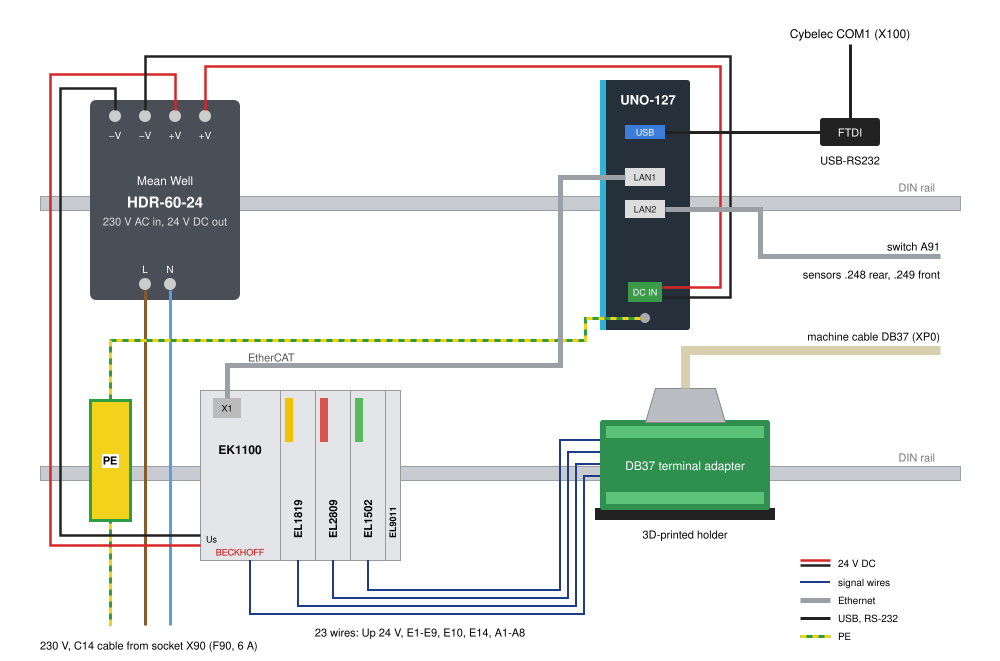

# LCB retrofit

Replacement for the laser angle measuring box (LCB, „WMS“) of an EHT VarioPress press brake with Cybelec
DNC 1200. Uses the existing cables, sensors, Cybelec settings and protocols.

| Part | Original box | Replacement |
|---|---|---|
| Computer | IEI PAC-400GW, CPU card PCISA-MARK-533 (VIA Nehemiah 532 MHz, 120 MB RAM), CF card | Advantech UNO-127, Debian 13, PREEMPT_RT kernel, read-only root (overlayroot) |
| Software | LCB version 1_4.08, ELinOS 4.1 (Linux 2.4.31 + RTAI), service tool „WMS4“ 2.30 | [`lcbd`](lcbd/): I/O sequences, angle measurement, CNC link, service page |
| Machine I/O | ADDI-DATA PA 1500 (ISA, 16 DI, 16 DO, 3 counters), DB37 | Beckhoff EtherCAT: EK1100, EL1819 (16 DI), EL2809 (16 DO), EL1502 (2 counters), EL9011 |
| CNC link | COM1 (DB9), NLR protocol | FTDI USB-RS232 adapter to Cybelec COM1, NLR protocol |
| Sensors | 2 laser line sensors, Ethernet | unchanged |
| Power | 230 V, IEC inlet | Mean Well HDR-60-24 (230 V AC -> 24 V DC) |

## Approach

1. Original box analysed at the machine for interoperability: I/O, CNC link, sensor protocol, sequences, captures.
2. Functional specification written, test vectors taken from the original box (results on recorded sensor frames).
3. Verified: results identical to the original box on 70,893 sensor frames (2 recorded bends + synthetic frames),
   then bench test and commissioning at the machine.

## Wiring



| UNO-127 port | To | Setting |
|---|---|---|
| LAN1 `ecat0` | EK1100 X1 -> EL1819 -> EL2809 -> EL1502 -> EL9011 | EtherCAT, no IP |
| LAN2 `sens0` | switch A91, sensors .248 rear, .249 front | 192.168.123.74/24, TCP 3000 |
| USB `/dev/ttyNLR` | FTDI USB-RS232 -> Cybelec COM1 (X100) | 9600 8N1, latency timer 1 ms |

Machine cable DB37 -> DB37 terminal adapter -> terminals:

| Signal | DB37 pin | Terminal point | Function |
|---|---|---|---|
| Up +24 V | 9, 28 | EK1100 2, 6 | machine 24 V for all I/O |
| Up 0 V | 10, 29 | EK1100 3, 7 | |
| E1 | 1 | EL1819 1 | 1 = cylinder up forbidden (Cybelec) |
| E2 | 20 | EL1819 2 | ref. switch front, 0 = at reference |
| E3 | 2 | EL1819 3 | ref. switch rear, 0 = at reference |
| E4 | 21 | EL1819 4 | cylinder down |
| E5 | 3 | EL1819 5 | push-button „WMS justieren“ |
| E6 | 22 | EL1819 6 | push-button „WMS aktivieren/absenken“ |
| E7 | 4 | EL1819 7 | die shift (PLC) |
| E8 | 23 | EL1819 8 | Cybelec „WMS aktiv“ |
| E9 | 5 | EL1819 9 | Cybelec „WMS inaktiv“ |
| E14 | 26 | EL1502 1, counter 1 | encoder rear, track A |
| E10 | 24 | EL1502 5, counter 2 | encoder front, track A |
| A1, A2 | 11, 30 | EL2809 1, 2 | drive front forward, back |
| A3, A4 | 12, 31 | EL2809 3, 4 | drive rear forward, back |
| A5, A6 | 13, 32 | EL2809 5, 6 | cylinder down, up |
| A7, A8 | 14, 33 | EL2809 7, 8 | lamps rear, front „Winkel gefunden“ |

| Power | From | To |
|---|---|---|
| 230 V | socket X90 behind F90 (6 A, on/off and reset) | HDR-60-24 AC |
| 24 V computer | HDR-60-24 | UNO-127 DC IN |
| Us | HDR-60-24 | EK1100 1 (+), 5 (0 V) |
| PE | C14 cable, UNO-127 earth cable | WAGO 2002-1207 on the DIN rail |

Us (power supply) and Up (machine) stay galvanically isolated, never connect them.

## Setup

Fresh UNO-127: BIOS on defaults, jumper PSON1 on AT (starts with the power), Debian 13 without desktop, with SSH
server, user `lcb` with sudo, LAN2 at a router with internet.

```
./deploy.sh setup lcb@ADDRESS   # then reboot
./deploy.sh status              # after the reboot, every line ok
```

`setup` installs the packages (RT kernel, build tools, overlayroot), copies [`uno/`](uno/) to `/` (service, udev rule,
network names, i915 blacklist, watchdog, journal), copies `configs/*.dat` to `/etc/lcbd` where missing, asks for the
service page password and enables `lcbd.service`. After the reboot the UNO is at 192.168.123.74 on LAN2 only. Write
protection after commissioning: `setup` again, answer y to overlayroot.

## Deploy

```
./deploy.sh [USER@HOST]            # default lcb@192.168.123.74
./deploy.sh rollback [USER@HOST]   # previous lcbd and lcb_test back
```

1. Downloads the SOEM archive once on the PC (the UNO has no internet).
2. Builds the committed state on the UNO and runs the tests (`nice 19`, lcbd keeps running).
3. Asks before the restart, installs `lcbd` and `lcb_test` live and on the eMMC below the overlayroot, keeps the
   previous ones as `*.prev`.
4. Restarts lcbd and checks for 30 s that the new binary runs without a restart, otherwise the previous binaries come
   back.

## Folders

| Folder | Content |
|---|---|
| [`lcbd/`](lcbd/) | source, tests, service page |
| [`configs/`](configs/) | example `setup.dat`, `sensor.dat`, `die.dat` |
| [`uno/`](uno/) | system files of the UNO, copied to `/` by `deploy.sh setup` |
| [`testdata/`](testdata/) | CNC link test vectors |
| [`3d-prints/`](3d-prints/) | DB37 adapter holder and DIN rail end cap (OpenSCAD + STL) |
| [`docs/`](docs/) | cabinet layout |

License: [MIT](LICENSE). `lcbd` links SOEM (GPLv3).
